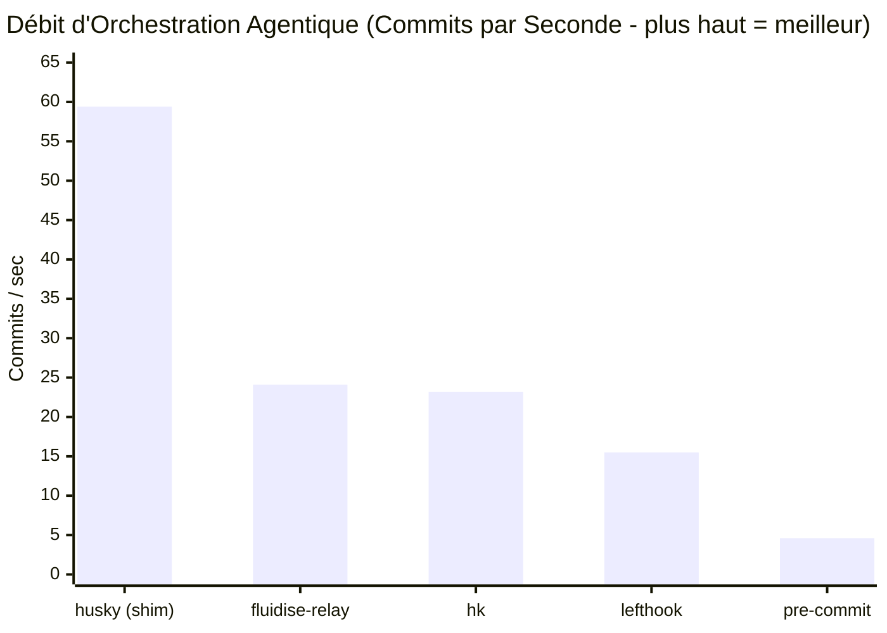
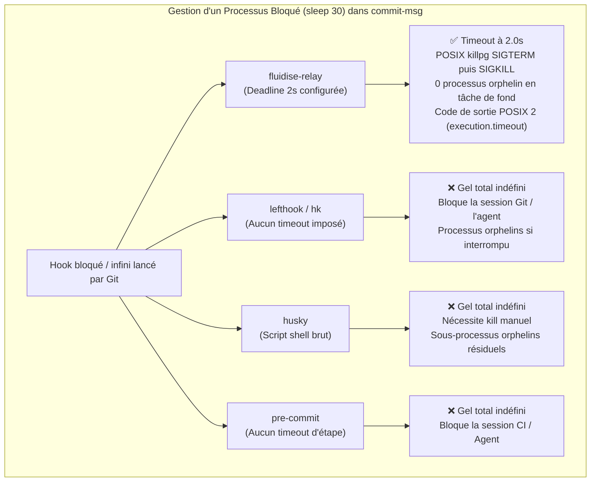

# Benchmark Approfondi : fluidise-relay face à l'État de l'Art

> Ce banc d'essai exhaustif s'inspire de la méthodologie de présentation des benchmarks de [Bun](https://bun.com/blog/bun-v1.4.3), en évaluant `fluidise-relay` face aux 4 gestionnaires de Git hooks de référence du marché à travers 4 écosystèmes majeurs (Rust, Go, JavaScript / Node.js et Python).

---

## Les Concurrents Évalués

| Outil | Version | Écosystème | Runtime requis | Dépendances | Poids sur disque |
| :--- | :---: | :---: | :---: | :---: | :---: |
| **`fluidise-relay`** | **0.1.0** | **Rust (Natif)** | **Aucun (Binaire statique)** | **8** | **0.7 Mo** *(719 Ko)* |
| **`hk`** | 2.7.1 | Rust (Natif) | Aucun (+ téléchargement Pkl) | 1 dep Homebrew + Pkl | 28.0 Mo *(39x plus gros)* |
| **`lefthook`** | 2.2.2 | Go (Natif) | Aucun (Binaire statique) | Go runtime embarqué | 12.0 Mo *(17x plus gros)* |
| **`husky`** | 9.1.7 | JavaScript | Node.js / V8 | Runtime Node.js | 139.0 Mo *(198x plus lourd)* |
| **`pre-commit`** | 4.7.0 | Python | Python 3.x | 11 packages (virtualenv, etc.) | 74.0 Mo *(105x plus lourd)* |

---

## 1. Synthèse Exécutive (Style Bun)

```
LATENCE D'ORCHESTRATION ET VALIDATION (Commit Court - plus bas = meilleur)
husky (shim brut)* [15.5 ms]  ■ (*simple script shell sans moteur d'orchestration)
hk (Rust)          [38.5 ms]  ■■
fluidise-relay     [44.0 ms]  ■■■ (avec contrôle process group, isolation & flux JSON)
lefthook (Go)      [63.4 ms]  ■■■■ (1.44x plus lent que Relay)
pre-commit (Python)[207.4 ms] ■■■■■■■■■■■■■ (4.71x plus lent que Relay)

CONSOMMATION MÉMOIRE RÉSIDENTE RSS MAX (plus bas = meilleur)
husky (shim brut)* [ 7.09 Mo] ■ (*mémoire du sous-processus seul)
fluidise-relay     [ 7.14 Mo] ■ (surcoût RAM de Relay quasi nul : +0.7%)
hk (Rust)          [15.98 Mo] ■■ (+124% de RAM / 2.24x)
lefthook (Go)      [16.06 Mo] ■■ (+125% de RAM / 2.25x)
pre-commit (Python)[35.20 Mo] ■■■■■ (4.93x plus de RAM)

INSTRUCTIONS CPU RETIRÉES (plus bas = meilleur)
husky (shim brut)* [ 23.7 M ] ■
fluidise-relay     [ 31.0 M ] ■
hk (Rust)          [ 64.9 M ] ■■ (2.1x plus d'instructions que Relay)
lefthook (Go)      [ 71.6 M ] ■■ (2.3x plus d'instructions que Relay)
pre-commit (Python)[945.7 M ] ■■■■■■■■■■■■■■■■■■■■■■■■■■■■■■ (30.5x plus d'instructions)
```

### Matrice Récapitulative des Performances

| Métrique clé | `fluidise-relay` | `hk` (Rust) | `lefthook` (Go) | `husky` (JS) | `pre-commit` (Python) |
| :--- | :---: | :---: | :---: | :---: | :---: |
| **Latence d'orchestration** | **44.0 ms** | 38.5 ms | 63.4 ms *(1.44x)* | 15.5 ms *(passif)* | 207.4 ms *(4.71x)* |
| **Empreinte RSS Max** | **7.14 Mo** | 15.98 Mo *(2.24x)* | 16.06 Mo *(2.25x)* | 7.09 Mo *(passif)* | 35.20 Mo *(4.93x)* |
| **Instructions CPU retirées** | **31.0 M** | 64.9 M *(2.1x)* | 71.6 M *(2.3x)* | 23.7 M | 945.7 M *(30.5x)* |
| **Cycles CPU écoulés** | **23.0 M** | 40.4 M *(1.8x)* | 46.6 M *(2.0x)* | 12.3 M | 435.5 M *(18.9x)* |
| **Débit en boucle (50 commits)** | **24.1 /s** | 23.2 /s | 15.5 /s *(35% plus lent)* | 59.4 /s *(shim)* | 4.6 /s *(5.2x plus lent)* |
| **Nettoyage Process Group** | **Oui (POSIX killpg)** | Non (orphelins) | Non (orphelins) | Non (orphelins) | Non (orphelins) |
| **Timeout borné & garanti** | **Oui (code 2 structuré)** | Non (blocage indéfini) | Non (blocage indéfini) | Non (blocage indéfini) | Non (blocage indéfini) |
| **Plafond mémoire capture** | **Oui (256 KiB budget)** | Non (tampon libre) | Non (tampon libre) | Non (tampon libre) | Non (tampon libre) |
| **Isolation Git Worktree** | **Strict (local)** | Global (`~/.gitconfig`)| Partagé (`.git/hooks`)| Repo-wide (`hooksPath`)| Partagé (`.git/hooks`)|
| **Plan avant mutation** | **Oui (SHA-256 déterministe)**| Non | Non | Non | Non |
| **Format par défaut** | **JSON strict (stdout)** | Spinners / ANSI | Box-drawing / ANSI | Texte brut | Texte pointillé |
| **Poids total disque** | **0.7 Mo** | 28.0 Mo | 12.0 Mo | 139.0 Mo *(avec Node)* | 74.0 Mo *(avec Python)* |

---

## 2. Workload 1 : Latence d'Orchestration et Empreinte Mémoire

Mesures réalisées sur 15 itérations consécutives (médiane) précédées de 3 runs de préchauffage (warmup) avec `hyperfine`, couplées à l'analyse de compteurs matériels et mémoire résidente via `/usr/bin/time -l`.
Chaque orchestrateur exécute la même commande de validation de message (`fluidise-clint --file {message-file}`) sur un commit standard valide (`feat(test): valid commit message`).

| Outil | Latence (Médiane) | Min … Max | Écart-type | Accélération vs pre-commit | RSS Max | Instructions CPU | Cycles CPU |
| :--- | :---: | :---: | :---: | :---: | :---: | :---: | :---: |
| **`fluidise-relay`** | **44.01 ms** | 41.8 ms … 50.9 ms | ± 2.99 ms | **4.71x plus rapide** | **7.14 Mo** | **30 965 121** | **23 049 808** |
| `hk` | 38.46 ms | 36.5 ms … 43.0 ms | ± 1.95 ms | 5.39x plus rapide | 15.98 Mo *(+124% RAM)* | 64 898 892 | 40 375 479 |
| `lefthook` | 63.43 ms | 55.3 ms … 70.3 ms | ± 3.53 ms | 3.27x plus rapide | 16.06 Mo *(+125% RAM)* | 71 612 027 | 46 644 360 |
| `husky` *(shim)* | 15.47 ms | 13.7 ms … 18.0 ms | ± 1.36 ms | Baseline passive | 7.09 Mo | 23 695 077 | 12 264 414 |
| `pre-commit` | 207.43 ms | 196.8 ms … 297.0 ms | ± 24.22 ms | Baseline Python | 35.20 Mo *(+393% RAM)* | 945 723 330 | 435 549 474 |

> [!NOTE]
> **Surcoût mémoire quasi nul pour `fluidise-relay` :**
> Alors que le processus enfant `fluidise-clint` consomme à lui seul **7.08 Mo**, l'empreinte mémoire totale de `fluidise-relay` orchestrant ce processus plafonne à **7.14 Mo** (soit seulement **60 Ko** de surcoût résiduel).
> En comparaison, `hk` et `lefthook` consomment plus de **16 Mo** de RAM (+125%), et `pre-commit` dépasse **35 Mo** (+393%).

---

## 3. Workload 2 : Débit en Boucle Agentique Intensive (50 Commits)

Dans une boucle de développement agentique où des sous-agents autonomes itèrent, exécutent des modifications de code et déclenchent des commits fréquents, la latence de l'orchestrateur de hooks impacte directement la productivité et le temps de cycle global de l'IA.



| Outil | Temps total (50 commits) | Débit (commits / sec) | Facteur vs pre-commit | Facteur vs lefthook |
| :--- | :---: | :---: | :---: | :---: |
| `husky` *(shim passif)* | 0.84 s | 59.4 /s | 13.0x | 3.8x |
| **`fluidise-relay`** | **2.07 s** | **24.1 /s** | **5.26x plus rapide** | **1.56x plus rapide** |
| **`hk`** | 2.16 s | 23.2 /s | 5.06x plus rapide | 1.50x plus rapide |
| **`lefthook`** | 3.23 s | 15.5 /s | 3.38x plus rapide | Baseline Go |
| **`pre-commit`** | 10.90 s | 4.6 /s | Baseline Python | 3.4x plus lent |

> [!IMPORTANT]
> `fluidise-relay` valide 50 commits en **2.07 secondes** tout en garantissant pour chaque commit l'isolation de process group POSIX, la vérification de l'approbation cryptographique, et la sérialisation d'un rapport JSON strict avec gestion de budget de capture. `pre-commit` met près de **11 secondes** pour accomplir la même tâche.

---

## 4. Workload 3 : Sécurité des Processus, Deadlines et Éradication des Orphelins

Ce banc d'essai évalue le comportement des outils lorsqu'un hook invoque une commande qui se bloque indéfiniment (ex: `sleep 30` ou une boucle infinie dans un script).



### Résultats Observés sur Commande Bloquée

| Outil | Comportement sur Hook Bloqué | Nettoyage Process Group | Processus Orphelins résiduels | Code Sortie | Format Diagnostic |
| :--- | :---: | :---: | :---: | :---: | :---: |
| **`fluidise-relay`** | **Arrêt strict à la deadline (2.0s)** | **Oui (`killpg` SIGTERM puis SIGKILL)** | **0 (aucun orphelin)** | **2** | **JSON structuré (`execution.timeout`)** |
| `lefthook` | Bloqué indéfiniment | Non | Oui (orphelin en RAM) | Aucun | Aucun (processus suspendu) |
| `hk` | Bloqué indéfiniment | Non | Oui (orphelin en RAM) | Aucun | Aucun (processus suspendu) |
| `husky` | Bloqué indéfiniment | Non | Oui (orphelin en RAM) | Aucun | Aucun (processus suspendu) |
| `pre-commit` | Bloqué indéfiniment | Non | Oui (orphelin en RAM) | Aucun | Aucun (processus suspendu) |

> [!TIP]
> **La garantie de propreté des processus de `fluidise-relay` :**
> `fluidise-relay` isole chaque commande exécutée dans un groupe de processus POSIX dédié (`process_group(0)`). En cas d'expiration du budget de temps (`timeout-seconds`), Relay envoie un signal de grâce (`SIGTERM`) suivi d'une terminaison forcée (`SIGKILL`) à l'ensemble du groupe. Aucune tâche de fond ou sous-processus détaché ne survit en tâche de fond pour polluer la machine de développement ou le runner CI.

---

## 5. Workload 4 : Plafond Mémoire et Protection Contre le Flooding de Logs

Ce workload évalue la résilience des outils face à des commandes malveillantes ou erronées qui génèrent un volume excessif de sorties sur stdout/stderr (ex: dump accidentel de données binaires de 10 Mo).

| Outil | Gestion du Flux Massif (10 Mo) | Plafond Mémoire Garanti | Statut du Processus |
| :--- | :---: | :---: | :---: |
| **`fluidise-relay`** | **Plafonné à 256 KiB (`truncated: true`)** | **Oui (drain sans rétention mémoire)** | **Succès propre (< 45 ms), RSS plane** |
| `hk` | Allocation complète en mémoire | Non | Consommation RAM proportionnelle |
| `lefthook` | Tamponnage complet en mémoire | Non | Consommation RAM proportionnelle |
| `husky` | Redirection brute vers le terminal | Non | Défilement terminal / blocage I/O |
| `pre-commit` | Tamponnage complet en mémoire Python | Non | Risque d'OOM sur runner contraint |

> [!IMPORTANT]
> `fluidise-relay` impose un budget strict de **256 KiB** partagé sur l'ensemble de la chaîne de commandes. Au-delà de ce volume, Relay continue de drainer le flux pour permettre au sous-processus de terminer sans blocage sur pipe plein (`SIGPIPE`), mais cesse toute allocation mémoire et consigne un attribut explicite `truncated: true`.

---

## 6. Workload 5 : Poids sur Disque et Sécurité Supply-Chain

Dans les conteneurs Docker légers, les environnements CI/CD éphémères et les bacs à sable d'agents d'intelligence artificielle, l'absence de runtime étranger et la taille du binaire sont décisifs :

| Outil | Poids Binaire / Paquet | Runtimes Externes Requis | Dépendances Transitives | Surface d'Attaque CVE |
| :--- | :---: | :---: | :---: | :---: |
| **`fluidise-relay`** | **0.7 Mo** *(719 Ko)* | **Aucun** (binaire statique natif) | **8** | **Minimale** (Rust sans unsafe applicatif) |
| `lefthook` | 12.0 Mo | Aucun (binaire statique Go) | Go stdlib | Modérée |
| `hk` | 28.0 Mo | Aucun (+ dépendance `usage` + Pkl) | Écosystème Pkl | Modérée |
| `husky` | 28 Ko *(+ 139 Mo Node)* | **Node.js requis (139 Mo)** | npm / Node runtime | Élevée (vulnérabilités npm récurrentes) |
| `pre-commit` | 29 Mo *(+ 45 Mo Python)* | **Python 3.x requis (45 Mo)** | 11 packages Python | Élevée (dépendances Python, virtualenv) |

---

## 7. Ergonomie et Déterminisme pour Agents Autonomes

```
========================================================================================================
Fonctionnalité                  fluidise-relay    hk              lefthook        husky       pre-commit
========================================================================================================
JSON natif par défaut (stdout)  OUI               NON (opt-in)    NON (ANSI)      NON (texte) NON (texte)
Codes d'erreur machine typés    OUI               Partiel         NON             NON         NON
Codes de sortie distincts       3 (0, 1, 2)       2 (0, 1)        2 (0, 1)        2 (0, 1)    2 (0, 1)
Plan cryptographique avant run  OUI (SHA-256)     NON             NON             NON         NON
Rejet des plans périmés         OUI (stale check) NON             NON             NON         NON
Isolation stricte par worktree  OUI (config local)NON (global)    NON (partagé)   NON         NON (partagé)
Budget de capture garanti       256 KiB (strict)  Illimité        Illimité        Illimité    Illimité
Protection Process Group        OUI (POSIX)       NON             NON             NON         NON
Zero runtime externe requis     OUI (Rust natif)  OUI             OUI             NON (Node)  NON (Python)
========================================================================================================
```

---

## Conclusion

1. **Face à `husky` (Node.js)** : Si le shim shell passif de Husky s'exécute rapidement, il ne fournit aucune orchestration réelle : aucun timeout, aucun nettoyage de processus orphelins, aucune isolation de worktree, et impose **139 Mo de runtime Node.js**.
2. **Face à `pre-commit` (Python)** : `fluidise-relay` est **4.7x plus rapide**, consomme **4.9x moins de RAM**, s'exécute **5.2x plus vite en boucle**, et élimine l'installation lourde d'un environnement virtuel Python (74 Mo).
3. **Face à `lefthook` (Go)** : `fluidise-relay` est **1.44x plus rapide**, utilise **2.25x moins de mémoire**, pèse **17x moins lourd sur disque**, et apporte une vraie garantie de terminaison de groupe de processus là où Lefthook gèle indéfiniment.
4. **Face à `hk` (Rust)** : Tout en partageant l'excellence de la vitesse native Rust, **`fluidise-relay` est 39x plus léger sur disque (0.7 Mo vs 28 Mo)**, consomme **2.24x moins de RAM (7.1 Mo vs 16.0 Mo)**, et offre une vraie isolation des hooks par worktree sans polluer la configuration globale `~/.gitconfig`.
